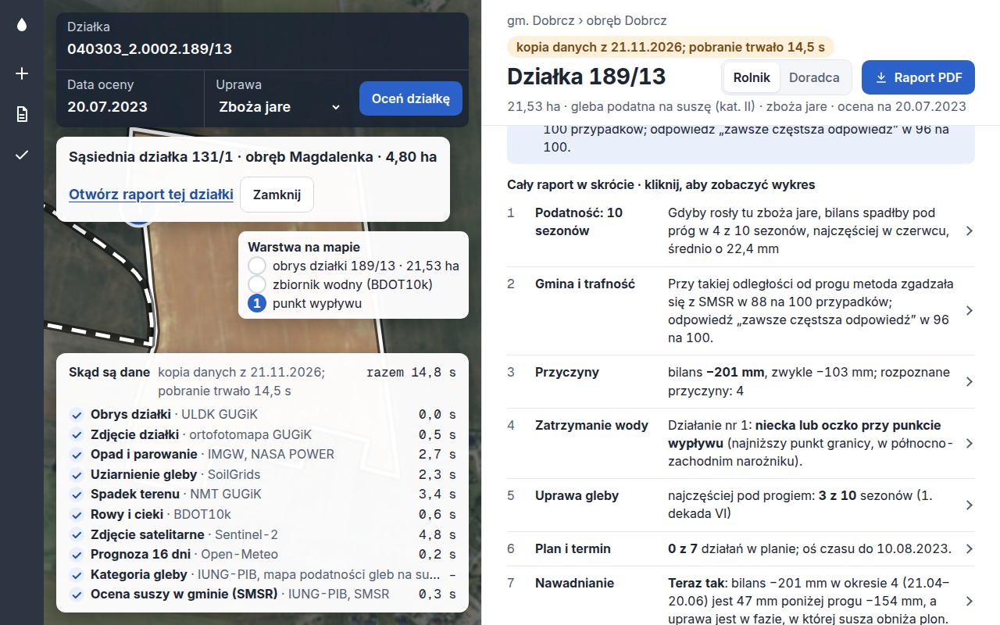

# Bilans działki

Raport dla jednej działki rolnej: bilans wody (opad minus parowanie) obok progu suszy z rozporządzenia, obok oceny SMSR IUNG dla gminy,
z działaniami „rozważ …” i miejscem na zatrzymanie wody zaznaczonym na ortofotomapie. Doradca wskazuje działkę numerem z ewidencji albo
kliknięciem na mapie, potem podaje datę oceny i uprawę.



## Co robi raport

- **Wskazanie działki.** Dwa sposoby: numer (np. `040303_2.0002.189/13`) albo klik na mapie startowej. Klik wysyła punkt do ULDK
  (`GetParcelByXY`), a aplikacja pokazuje obrys i numer do potwierdzenia. Kafle mapy podkładowej i ortofotomapy podaje nasz serwer,
  przeglądarka nie łączy się z GUGiK.
- **Werdykt.** Bilans wody działki w oknie 6 dekad, porównany z progiem z rozporządzenia Dz.U. 2019 poz. 739 dla grupy upraw
  (14 grup) i kategorii gleby (I–IV). Drugi wariant parowania (wzór Doroszewskiego–Górskiego) stoi w widoku doradcy.
- **Zgodność z SMSR.** Odpowiedź „pod progiem / nad progiem” obok oceny SMSR IUNG dla gminy i rok analizy.
- **Przyczyny i działania.** Przyczyny z dowodem liczbowym (pogoda z rankingiem w mm; miejsce i uprawa bez rankingu), mechanizm,
  miejsce na działce i zdanie „rozważ …, jeśli …; następny krok …”. Lokalizację i zgody (Prawo wodne) trzeba zweryfikować na miejscu.
- **Plan i PDF.** Przełącznik „W planie” przy działaniu, termin, raport do wydruku i PDF.
- **Prognoza przekroczenia progu.** Szansa, że do końca okresu krytycznego bilans spadnie pod próg.
- **Dwa widoki.** „Rolnik”: góra ekranu ma najwyżej 7 wierszy skrótu, rozwijane wiersze dają liczby, przyczyny, plan i opis liczenia.
  „Doradca”: pełne liczby, wejścia i niepewność.

Czego raport nie podaje: milimetrów wody odpływającej z działki ani objętości odpływu. Współczynnika spływu dla pól ze źródłem nie mamy.

## Liczby z pomiaru (`make eval`, `metrics.json`)

**Zgodność z SMSR** (wariant aplikacji: ET0 FAO-56). Próba: 149 gmin, `n_gmina_years` = 1017 gmino-lat, 566130 symboli „+” lub „-”;
częstość „+” w SMSR 4,5%.

| Miara | Wynik | Linia odniesienia |
|---|---|---|
| CSI | 0,3699 (przedział 95%: 0,3387–0,3988) | klimatologia 0,0694; siatka NASA POWER 0,147; „zawsze susza” 0,045 |
| POD (czułość) | 0,4133 | |
| FAR | 0,2211 | |
| Peirce | 0,4077 | |
| trafność | 0,9683 | zawsze częstsza odpowiedź: 0,955 |
| trafność zrównoważona | 0,7039 | klimatologia 0,5377 |
| precyzja | 0,7789 | |

Zgodność rośnie z odległością bilansu od progu: 0,5517 dla 0–10 mm, 0,7051 dla 10–25 mm, 0,8823 dla 25–50 mm, 0,9964 powyżej 50 mm.

**Dwa warianty parowania** na tych samych gminach testowych:

| Miara | ET0 FAO-56 (w aplikacji) | Doroszewski–Górski |
|---|---|---|
| CSI | 0,3699 | 0,4599 |
| POD | 0,4133 | 0,5166 |
| FAR | 0,2211 | 0,1929 |
| Peirce | 0,4077 | 0,511 |
| trafność zrównoważona | 0,7039 | 0,7555 |

Wzór Doroszewskiego–Górskiego wypada lepiej, także na gminach wyboru wariantu (0,7369 wobec 0,7002). Mimo to werdykt dalej liczymy
z FAO-56: wzór D–G mamy z postaci miesięcznej w publikacji IUNG 2023, nie z oryginalnego tekstu, i nie zdecydowaliśmy o zmianie.
Przesunięcie progu o 53 mm podnosi trafność zrównoważoną na 2026 z 0,7727 do 0,9094. Dopasowaliśmy go do ocen IUNG
na latach 2020–2025; to nie jest niezależny pomiar i w werdykcie go nie stosujemy.

**Prognoza przekroczenia progu**, walidacja krocząca: 200 gmin, 8000 przypadków, lata testowe 2016–2025, rok Y liczony tylko z lat
wcześniejszych. Podajemy porównanie trzech podejść.

| Podejście | Brier | BSS wobec częstości historycznej |
|---|---|---|
| częstość historyczna | 0,0705 | 0 (punkt odniesienia) |
| dopełnianie przebiegami (w aplikacji) | 0,0558 | 0,2081 (przedział 95%: 0,1826–0,2329) |
| LightGBM | 0,0583 | 0,1724 |

LightGBM nie pobił dopełniania, więc nie jest w aplikacji. Dla szansy od 50%: trafność 0,927 (częstość historyczna 0,9094, zawsze
częstsza odpowiedź 0,9091), czułość 0,3232 (0,1045), precyzja 0,7187 (0,5067). Kalibracja w 10 przedziałach: `metrics.json`, `forecast.calibration`.

**Kategoria gleby z uziarnienia SoilGrids** wobec mapy IUNG, 96 punktów: dokładnie ta sama kategoria 0,375, w granicach jednej
kategorii 0,8958.

### Miary jednym zdaniem

Dla rolnika:
- **trafność**: odsetek przypadków, w których odpowiedź „pod progiem / nad progiem” była taka jak w SMSR; obok stoi „zawsze częstsza odpowiedź”.
- **trafność zrównoważona**: średnia z odsetka trafionych susz i odsetka trafionych „bez suszy”, więc nie wygrywa jej odpowiedź „zawsze nie”.
- **czułość** (POD): z ilu susz według SMSR wskazaliśmy suszę.
- **precyzja**: ile z naszych alarmów SMSR potwierdził.

Dla jury:
- **CSI**: trafienia podzielone przez trafienia, chybienia i fałszywe alarmy; pomija zgodne „bez suszy”.
- **POD**: to samo co czułość.
- **FAR**: odsetek naszych alarmów, których SMSR nie potwierdził.
- **Peirce**: czułość minus odsetek fałszywych alarmów wśród przypadków bez suszy; 0 to brak umiejętności.
- **Brier**: średni kwadrat błędu prognozowanego prawdopodobieństwa; mniej znaczy lepiej.
- **BSS**: 1 − Brier / Brier częstości historycznej; powyżej 0 to lepiej niż częstość historyczna; kalibracja zestawia szansę z tym, co się stało.

## Metoda

Ocena bieżąca nie używa uczenia maszynowego: każdą liczbę daje rachunek albo reguła.

- **Bilans i próg.** Opad minus parowanie w oknie 6 dekad kończącym się na ostatniej pełnej dekadzie, próg z Dz.U. 2019 poz. 739.
- **Kategoria gleby.** Mapa IUNG, gdy odpowiada dla punktu. Inaczej reguła z uziarnienia 0–30 cm (SoilGrids) do kategorii I–IV.
- **Roślinność.** Odchylenie NDVI od własnej historii działki w tej samej fazie rozwoju, nie średnia regionu; maska chmur SCL.
- **Prognoza.** Dopełnianie bieżącego okna przebiegami pogody z tych samych dni kalendarza we wcześniejszych latach, pierwsze 16 dni
  prognozą Open-Meteo. Bez zapisanych wag, więc bez wycieku danych. Dla daty z przeszłości rok analizy nie wchodzi do danych prognozy.
- **Podpowiedź uprawy.** Mapa upraw JRC EUCROPMAP 2022 w obrysie, tylko jako podpowiedź nad listą; mapa nie dzieli zbóż na ozime i jare.
- **Rozmieszczanie działań.** Płaszczyzna z = ax + by + c dopasowana metodą najmniejszych kwadratów do wysokości w obrysie daje spadek
  w % i kierunek. Dalej: dolny odcinek granicy, najniższy punkt granicy, zagłębienia (oczko niższe od 8 sąsiadów) i najbliższy rów
  z BDOT10k. Zlewnię działki liczymy z siatki z marginesem ok. 300 m.
- **Rozszerzenia do porównania.** Akumulacja spływu D8: O'Callaghan J.F., Mark D.M. 1984, „The extraction of drainage networks from
  digital elevation data”, Computer Vision, Graphics, and Image Processing 28(3), 323–344. Oraz mediana NDMI z suchych okresów Sentinel-2
  (definicja suchego okresu to propozycja zespołu). Metody pochodzą z klasycznej literatury; patentu na nie nie znaleźliśmy
  (wyszukiwanie 21.11.2026). Aplikacja bierze wariant z najwyższym wynikiem w pomiarze, a przy braku pomiaru podstawę (najniższy punkt granicy).

### Od bazy 26 działań do zdania

1. Baza 26 działań w CSV (`app/advice/catalog.csv`, `catalog_retencja.csv`): źródło, strona, cytat, poziom pewności. Efekt tylko jako zakres
   z literatury. Próg z poradnika CDR 2025 ma stronę; bez strony jest oznaczony „propozycja zespołu”.
2. Przyczyna z osią i dowodem (`app/advice/diagnosis.py`).
3. 9 mechanizmów (`app/advice/mechanisms.csv`): w sezonie trzeba potrzeby ORAZ możliwości z terenu, poza sezonem wystarcza możliwość.
4. Miejsce na działce z modelu terenu (`app/advice/placement.py`, `terrain_model.py`) albo powód braku miejsca.
5. Kolejność po liczbie przyczyn, wykonalności i tym, czy rolnik zrobi to sam; najwyżej 3 działania na grupę.
6. Zdanie z liczbami działki, terminem i formalnością z Prawa wodnego (`app/advice/prawo_wodne.csv`).

## Uruchomienie

Windows, bez `make` (potrzebny [uv](https://docs.astral.sh/uv/)):

```
uv sync
uv run python -m app
```

Potem w przeglądarce: http://127.0.0.1:8000 (port zmienia zmienna `HN_PORT`). W Linuksie i macOS: `make setup`, `make serve`, `make test`.
Demo na kopii danych dwóch działek (bez sieci): `make demo`. Na żywo aplikacja pobiera dane dla dowolnej działki; kopia stoi w `demo/data/`.

## Źródła i licencje

Pełna tabela z adresami, licencjami i datami pobrania: [docs/DANE.md](docs/DANE.md). Licencje danych: ULDK i ortofotomapa GUGiK, BDOT10k
i NMT (dane publiczne GUGiK), IMGW-PIB (dane publiczne, podajemy źródło), Open-Meteo i SoilGrids i JRC EUCROPMAP (CC BY 4.0, Open-Meteo
tylko niekomercyjnie), NASA POWER i Sentinel-2 (dane otwarte), SMSR (dane IUNG-PIB, podajemy źródło). Licencja kodu: MIT, plik `LICENSE`.
Zakres przepisów i danych: rozporządzenie Dz.U. 2019 poz. 739, Prawo wodne (Dz.U. 2026 poz. 1335), poradnik CDR 2025, FAO-56.

## Uczciwe ograniczenia

- Demo jedzie na kopii danych dwóch działek (stan 21.11.2026), nie na żywych odpowiedziach. Działanie na żywo pokazuje pomiar
  odporności (`robustness.*` w `metrics.json`), a tego pomiaru jeszcze nie ma: nie wpisujemy z niego liczb.
- Sprawdzenia miejsc retencji (punkt wypływu wobec rowów: `retention.outlet_hit_*`; niecka wobec zbiorników: `retention.pond_auc_*`)
  nie zmierzyliśmy: usługa ULDK zwracała błędne odpowiedzi i nie zebraliśmy 50 działek z rowem. Dlatego aplikacja bierze podstawę
  (najniższy punkt granicy), a warianty D8 i NDMI nie są w aplikacji. Gdy je zmierzymy, wynik będzie optymistyczny: rów jest w modelu
  terenu zagłębieniem.
- Zgodność roślin z mapą JRC (`crop.rotation_agreement_jrc`) nie jest w `metrics.json`; mapa nie rozróżnia zbóż ozimych i jarych.
- Zgodność reguły gleby z mapą IUNG to 0,375 na 96 punktach (w granicach jednej kategorii 0,8958); to słabo, więc kategorię z mapy IUNG
  bierzemy, gdy odpowiada, a regułę tylko jako zapas.
- Zgodność z SMSR mierzymy symbolami „+” i „-”, nie w mm: tabele IUNG nie podają wartości KBW. Nasz CSI 0,3699 jest
  wyraźnie nad klimatologią (0,0694), ale czułość 0,4133 znaczy, że nie wskazujemy większości susz z SMSR.
- Nie znamy wzoru, którym IUNG liczy parowanie w SMSR; wzór D–G pochodzi z publikacji IUNG 2023 w postaci miesięcznej.
- Zlewnia bywa ucięta przez siatkę (margines ok. 300 m); o drenaż nie pytamy, zakładamy „nieznane”, więc regulator drenów to potencjał
  o niskiej pewności. Progi oznaczone „propozycja zespołu” (odległość rowu, wysokość piętrzenia, spadki, głębokość zagłębienia) nie mają
  źródła w poradniku CDR 2025.
- Przepisy: regulator drenów to art. 395 pkt 16 i 395a (regulacja istniejącego urządzenia: pkt 12), przebudowa rowu pkt 15; granica
  między pkt 11 i 15 nie jest zdefiniowana w ustawie. Nowelizacji poz. 1358 i 1156 nie otwieraliśmy.
- Łańcuch przyczyna → mechanizm → miejsce ma luki: miejsce na działce liczy `app/advice/placement.py` (z `terrain_model.py`), ale
  osobnych detektorów kandydatów (pas trawy, miedza, uprawa w poprzek stoku, niecka) ani modułu walidacji (zlewnia zewnętrzna,
  miejsce blisko granicy) jeszcze nie ma. Mechanizmy bez miejsca (zastawka w rowie, regulator drenów, parowanie, pojemność gleby,
  brakujący opad) idą do raportu jako zdanie bez geometrii.
- Milimetrów wody odpływającej z działki raport nie podaje.
- Open-Meteo działa bezpłatnie tylko niekomercyjnie i ma dzienny limit zapytań; IMGW publikuje archiwum z 1–2 miesięcznym opóźnieniem.
